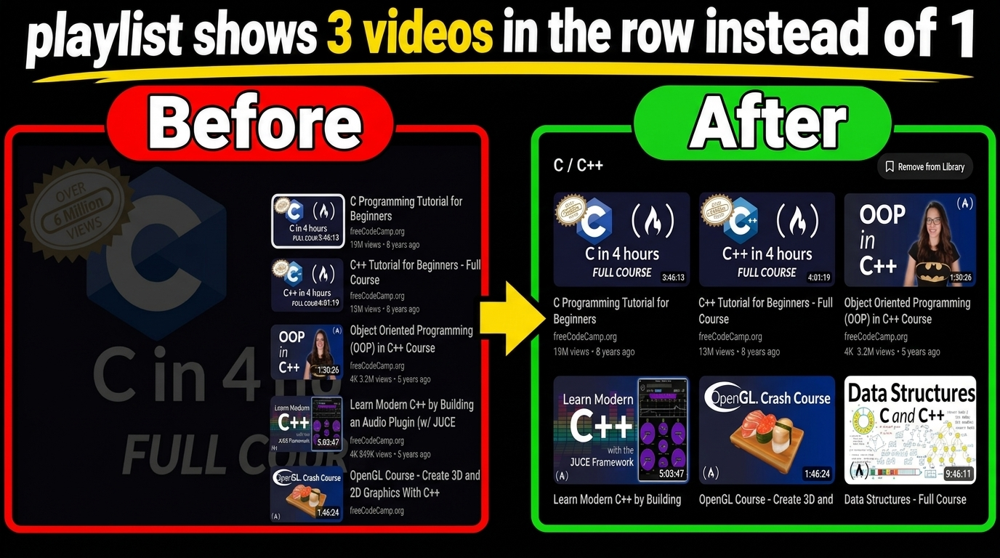
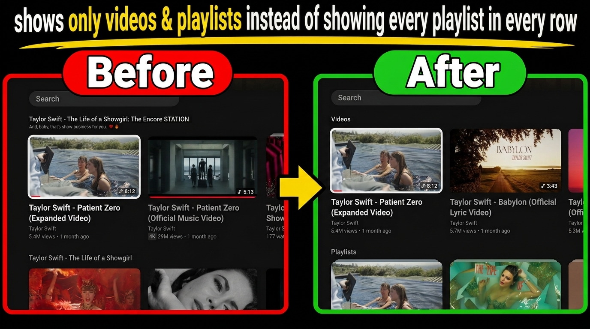

# ▶️ TizenTube ( with Vanced legacy icon )

    

Download from [here](https://github.com/peteramir/TizenTubeVancedIcon_-Pause-Play-ButtonsWorkOnTizen-4.0/releases/download/fixes/TizenTube.wgt) ( it can be installed besides the official TizenTube because it has a different package ID and a different icon ).

This Standalone version is forked from [v2.0.1 Version](https://github.com/reisxd/TizenTube/releases/tag/v2.0.1)

The fork uses a custom-hosted [UserScript](https://cdn.jsdelivr.net/npm/@shadowtube/tizentube-noanimations/dist/userScript.js) maintained by me. I also modified the script to use ES5-compatible JavaScript syntax for older Chromium environments, including Tizen 4.0 (M56).

I could fix "pause" and "play" buttons on Tizen 4.0 legacy TV with exact same remote in the attached photo ( the last line from the bottom ).
[See the Samsung TV remote layout](.github/assets/Samsung_TV_Remote.png)

Note: My Samsung TV model is: ua49n5300 49 inch ( this fork only tested on Tizen 4.0 )

Reasons to install this fork ( can be installed beside the installed app since my fork have a different packageID + different icon ):
I added these toggle options to [Reis's userScript.js](https://cdn.jsdelivr.net/npm/@foxreis/tizentube/dist/userScript.js):

1- Listing 3 videos in row for playlists

2- Showing only videos and playlists when visiting a channel ( you still can scroll to bottom and click on "videos" to be able to sort the videos from "most popular" and to to list 3 videos in the row ).

3- "Fix Subtitle Sync": I added an option below "Turn off screen" option. it fixes subtitle sync by making the container of the subtitle container occupies 66% of the screen of the TV.
Notes:
- The adjustment applies to the currently playing video and the immediately following video only. It does not carry over to subsequent videos.
- Use this option only when experiencing subtitle synchronization issues, as not all videos have this problem.
 

4- Seek with 1 tap ( seek 10+/10- without showing the annoying UI with just a single tap ).
Notes:
- Seeking with 1 tap doesn't work when the video is paused ( I made it intentionally to be able to navigate between ending cards but you need to pause the video first ).
- I didn't like to make "ok" button to pause the video because I used to using "pause" and "play" buttons on the remote.
- You can seek forward or backward by 10 seconds with a single press of the Left/Right buttons on the remote, even while changing video settings such as quality or playback speed.

5- Black Amoled theme.

Credits: [axotube](https://github.com/TizenDroid/axotube) | [here](https://raw.githubusercontent.com/TizenDroid/axotube/refs/heads/main/dist/userScript.js) | [here](https://cdn.jsdelivr.net/gh/TizenDroid/axotube/dist/userScript.js).

6- Changed code of "Adblock".

Credits: [VacuumTube](https://github.com/shy1132/VacuumTube/blob/main/src/preload/modules/adblock.js).

7- Changed code of "SponsorBlock" ( modified the initializing SponserBlock in the project to fix the memoryleak ). I modified [VacuumTube](https://github.com/shy1132/VacuumTube/blob/main/src/preload/modules/sponsorblock.js) code to add these 3 features :

- segment colors doesn't disappear when seeking the video on progress bar + when "auto-skip" toggle option is enabled for a specific category, when come back to the same segment is asks for confirmation and doesn't auto-skip in the second time for the single segment.
- SponserBlock works when being in the range time of the segment ( no need watch the video normally to skip the sponser ) ; so it means that if you seeked the video time to the time in the range of the segment SponserBlock will work perfectly.
- when it skip an "Ending/credits" in the end of the video it auto-plays to the next video instead of re-playing the same video ( works only VacuumTube , it doesn't work on Tizen 4.0 OS ).

Credits: [VacuumTube](https://github.com/shy1132/VacuumTube/blob/main/src/preload/modules/sponsorblock.js).

8- Splitted "Fix UI" option to 6 options ( enable only the first 4 ) ( enabling "Fix UI" toggle option in [Reis's userScript](https://cdn.jsdelivr.net/npm/@foxreis/tizentube/dist/userScript.js) checks the first 5 options together ):

- Disable limited-memory mode.
- Full-animation app quality.
- Enable list animations.
- Enable long press.
- Remove app-quality class.
- Keep app-quality class.

9- Being able to choose the client for user-agent spoofing:

- OFF (no spoofing).
- Tizen 4.0 (Samsung 2018).
- Sony SOV38 (Android 10).
- Chromecast (Android 14).
- TCL Smart TV Pro (Android 12).
- Amazon AFTMM (Android 7.1.2)

10- Disable animations ( it's a bad option don't enable it, I added it in case anybody like this option, enabling this option makes thumbnails and video Titles load slower while navigating on the home feed + makes a noticeable delay in the subtitle sync, don't enable this option unless you are okay with these 2 downsides ).

11- "pause" + "play" buttons works on Tizen 4.0 legacy Remote.

you can see its code [here](https://github.com/peteramir/TizenTubeVancedIcon_-Pause-Play-ButtonsWorkOnTizen-4.0/blob/main/standalone/service/patch.js)

12- Refresh page 'F5' ( press on it after making changes in toggle options ).

## ⚠️ Disclaimer

**This project is NOT affiliated, associated, authorized, endorsed by, or in any way officially connected with Samsung, Tizen, or YouTube.**

Send me a message on my Telegram and tell me if it helped you with your own Tizen 4.0: https://t.me/username309x

Forks I appreciate its work: [axotube](https://github.com/TizenDroid/axotube) | [KrX3D](https://github.com/KrX3D/TizenTube)

Credits go to Special thanks to [Reis](https://github.com/reisxd/TizenTube), the original author, for building the core project.
