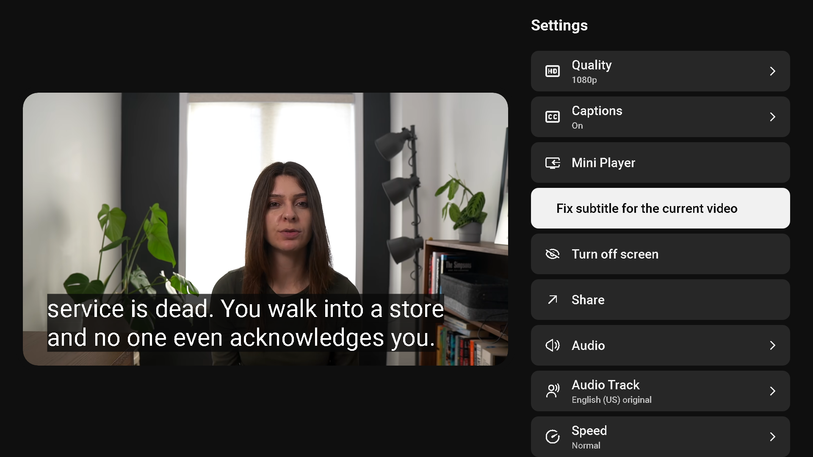

# ▶️ TizenTube ( with Vanced legacy icon )

    

Download from [here](https://github.com/peteramir/TizenTubeVancedIcon_-Pause-Play-ButtonsWorkOnTizen-4.0/releases/download/fixes/TizenTube.wgt) ( it can be installed besides the official TizenTube because it has a different package ID and a different icon ) | [How to install .wgt file](https://github.com/peteramir/TizenTubeVancedIcon_-Pause-Play-ButtonsWorkOnTizen-4.0/blob/main/.github/assets/How_to_install_wgt_file_to_Samsung_Smart_Tv.md)

This standalone version is based on TizenTube [v2.0.1](https://github.com/reisxd/TizenTube/releases/tag/v2.0.1)

The app loads my own [UserScript](https://cdn.jsdelivr.net/npm/@shadowtube/tizentube-noanimations/dist/userScript.js) from this link, which I maintain and keep updated.

I could fix "pause" and "play" buttons on Tizen 4.0 legacy TV with exact same remote in the attached photo ( the last row from the bottom ).
[See the Samsung TV remote layout](.github/assets/Samsung_TV_Remote.png)

Note: My Samsung TV model is: ua49n5300 49 inch ( this fork only tested on Tizen 4.0 )

Reasons to install this fork ( can be installed beside the installed app since my fork have a different packageID + different icon ):
I added these toggle options to [Reis's userScript.js](https://cdn.jsdelivr.net/npm/@foxreis/tizentube/dist/userScript.js):

**1- Listing 3 videos in row for playlists.**

**2- When visiting a channel, only videos and playlists are displayed initially. You can still scroll down and select "Videos" to access sorting options such as "Most popular", while keeping the 3-videos-per-row layout.**

**3- "Fix Subtitle Sync": I added an option below "Turn off screen" option. It fixes subtitle synchronization issues by setting the subtitle container width to 66% of the TV screen.**
Notes:
- This option affects the currently playing video and the next video only.
- Use this option only when experiencing subtitle synchronization issues, as not all videos have this problem.
 

**4- Seek with 1 tap ( seek 10+/10- without showing the annoying UI with just a single tap ).**
Notes:
- Seeking with 1 tap doesn't work when the video is paused ( I made it intentionally to be able to navigate between ending cards but you need to pause the video first ).
- I didn't like to make "ok" button to pause the video because I used to using "pause" and "play" buttons on the remote.
- If you're changing video settings, such as quality or playback speed, while the video is playing, you can still use the Left/Right buttons on the remote to seek forward or backward by 10 seconds.

**5- Black Amoled theme.**

Credits: [axotube](https://github.com/TizenDroid/axotube) | [here](https://raw.githubusercontent.com/TizenDroid/axotube/refs/heads/main/dist/userScript.js) | [here](https://cdn.jsdelivr.net/gh/TizenDroid/axotube/dist/userScript.js).

**6- Changed code of "Adblock".**

Credits: [VacuumTube](https://github.com/shy1132/VacuumTube/blob/main/src/preload/modules/adblock.js).

**7- Modified SponsorBlock initialization to fix a memory leak.**

I also adapted and improved parts of VacuumTube's SponsorBlock implementation to introduce the following three enhancements:

- **Persistent segment colors when seeking:** SponsorBlock segment colors remain visible on the progress bar while seeking. Additionally, when auto-skip is enabled for a specific category, the same segment is automatically skipped again if the user seeks back into it, without requiring confirmation.

- **Skip segments immediately upon seeking into them:** SponsorBlock detects when the playback position enters a segment's time range and skips it immediately, without requiring the user to play through the video normally to reach that segment.

- **Improved end-screen handling:** When SponsorBlock skips an "Ending/Credits" segment at the end of a video, playback automatically advances to the next video instead of replaying the current one. (This behavior is supported by VacuumTube but does not work on Tizen 4.0.)

**Credits:** [VacuumTube](https://github.com/shy1132/VacuumTube/blob/main/src/preload/modules/sponsorblock.js) (original implementation adapted and improved).

**8- Splitted "Fix UI" option to 6 options** ( enable only the first 4 ) ( enabling "Fix UI" toggle option in [Reis's userScript](https://cdn.jsdelivr.net/npm/@foxreis/tizentube/dist/userScript.js) checks the first 5 options together ):

- Disable limited-memory mode.
- Full-animation app quality.
- Enable list animations.
- Enable long press.
- Remove app-quality class.
- Keep app-quality class.

**9- Being able to choose the client for user-agent spoofing:**

- OFF (no spoofing).
- Tizen 4.0 (Samsung 2018).
- Sony SOV38 (Android 10).
- Chromecast (Android 14).
- TCL Smart TV Pro (Android 12).
- Amazon AFTMM (Android 7.1.2)

**10- Disable animations.**

Note: This option has two known drawbacks:
- Thumbnails and video titles load more slowly when navigating the home feed.
- Subtitle synchronization may experience noticeable delays.

Recommended: Keep this option disabled unless you prefer the reduced animations and accept these trade-offs.

**11- "pause" + "play" buttons works on Tizen 4.0 legacy Remote.**

you can see its code [here](https://github.com/peteramir/TizenTubeVancedIcon_-Pause-Play-ButtonsWorkOnTizen-4.0/blob/main/standalone/service/patch.js)

**12- Refresh page 'F5' ( press on it after making changes in toggle options ).**

## ⚠️ Disclaimer

**This is an independent, community-developed project and is not affiliated with, endorsed by, or officially associated with Samsung, Tizen, or YouTube.**

Send me a message on my Telegram and tell me if it helped you with your own Tizen 4.0: https://t.me/username309x

Forks I appreciate its work: [axotube](https://github.com/TizenDroid/axotube) | [KrX3D](https://github.com/KrX3D/TizenTube)

Special thanks to [Reis](https://github.com/reisxd/TizenTube), the original author of TizenTube, for building the core project.
